<picture>
  <source media="(prefers-color-scheme: dark)" srcset="assets/terminal-dark.svg">
  
</picture>

<picture>
  <source media="(prefers-color-scheme: dark)" srcset="assets/ticker-dark.svg">
  
</picture>

<p>
  <a href="https://enartey.vercel.app"></a>
  <a href="https://www.linkedin.com/in/ethan-nartey-4a0356332"></a>
  <a href="https://github.com/enartey25?tab=repositories"></a>
</p>

I build software and the models behind it. I'm an engineering student at the University of Ghana working toward a career in software, ML or AI engineering, or data science. Quant research is the side hustle: I read the markets every day and backtest ideas when they won't leave me alone. I also take networks apart now and then.

## `$ ls ~/live`

| Project | What it does | Run it |
|---|---|---|
| **[SES-GPT](https://github.com/enartey25/SES-GPT)** | RAG pipeline that answers questions from school and department chats | [ses-gpt.vercel.app](https://ses-gpt.vercel.app) |
| **[WatchTower](https://github.com/enartey25/WatchTower)** | Movie recommender built on TF-IDF and weighted search | [watch-tower-ashy.vercel.app](https://watch-tower-ashy.vercel.app) |

## `$ git log --projects`

```text
ai/llm        TRACiE ................ assistant for exploring team codebases
software      Hunu .................. extension + site + API ranking prices across Jumia, Jiji, AliExpress, Amazon
ml/quant      EPL Meta-Model ........ stacked XGBoost + Random Forest, calibrated Poisson goal forecasts
data-eng      HSI ETL Pipeline ...... Hang Seng Index daily history into a warehouse
classical-ml  Spam Detection ........ TF-IDF across Naive Bayes, LogReg, SVM; scored on F1 and ROC-AUC
deep-learning ANN vs CNN ............ digit classification head-to-head in TensorFlow/Keras
data-science  Customer Segments ..... K-Means segments with marketing recommendations
vision        Haar Face Detector .... real-time OpenCV webcam detection, tunable live
```

[TRACiE](https://github.com/enartey25/TRACiE) ·
[Hunu](https://github.com/enartey25/Hunu) ·
[EPL Meta-Model](https://github.com/enartey25/EPL-Meta-Model-and-Poisson-Goal-Model-System) ·
[HSI ETL](https://github.com/enartey25/HSI-ETL-Pipeline) ·
[Spam Detection](https://github.com/enartey25/Spam-Email-Detection) ·
[ANN vs CNN](https://github.com/enartey25/ANN-vs-CNN) ·
[Customer Segments](https://github.com/enartey25/Customer-Segmentation-Notebook) ·
[Haar Face Detector](https://github.com/enartey25/Interactive-Haar-Cascade-Frontal-Face-Detector)

## `$ cat roles.txt`

- **Vice President**, National Society of Black Engineers, University of Ghana Chapter
- **Team Lead, Data Science Club**, UG Actuarial and Statistics Society (UGASS)

## `$ which stack`


## `$ git stats`


